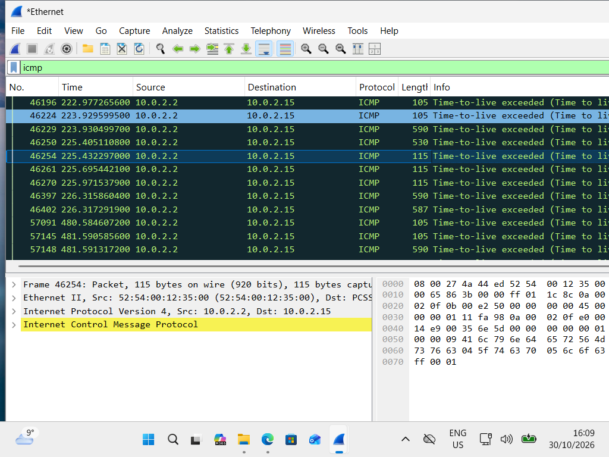
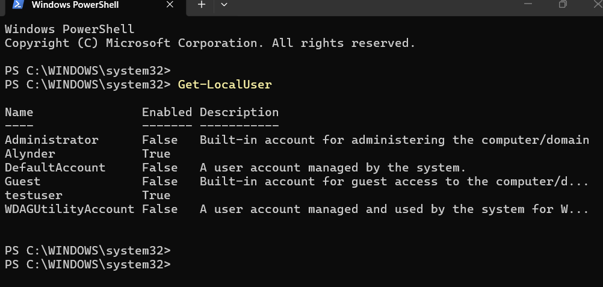

# Lab 01: Networking & OS Baseline

## 🎯 Objective
To establish a baseline understanding of network traffic and local operating system users within a Windows 11 Virtual Machine.

## 🛠️ Tools Used
- VirtualBox (Windows 11 VM)
- Wireshark
- Windows PowerShell

## 📝 Process & Evidence

### Part 1: Network Traffic Analysis (Wireshark)
I captured network traffic inside the VM while using the `ping` command. 
- **Action:** Filtered traffic using `icmp`.
- **Result:** Observed ICMP packets. The "Time-to-live exceeded" message confirms the packets successfully left the VM's virtual network and reached external routing infrastructure.

### Part 2: OS Enumeration (PowerShell)
I used PowerShell to enumerate local user accounts.
- **Command:** `Get-LocalUser`
- **Result:** Successfully listed the local accounts, including the active user profile and built-in Administrator/Guest accounts.

## 💡 What I Learned
- How to isolate and analyze specific protocols in Wireshark.
- How virtual network adapters (NAT) handle outbound traffic.
- Basic OS enumeration using PowerShell to understand the local attack surface.
